<p align="center">
  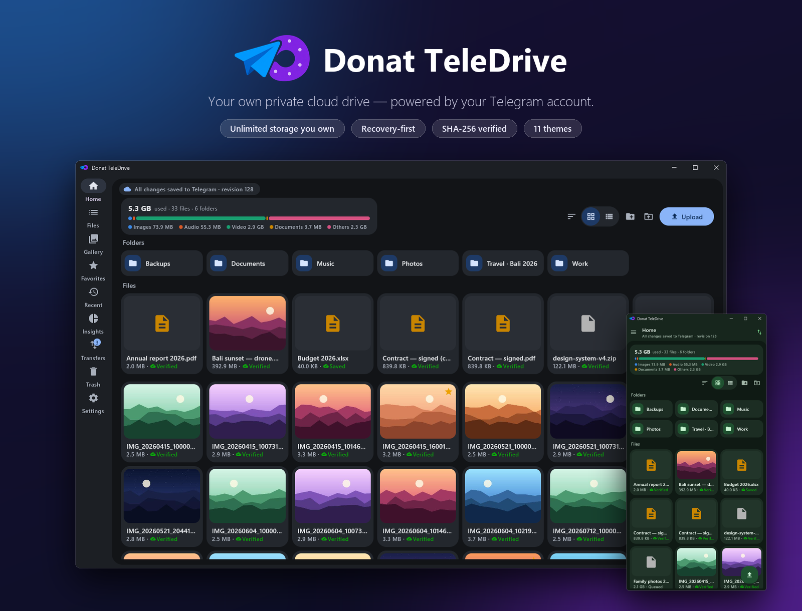
</p>

<p align="center">
  <b>A beautiful, recovery-first cloud drive for Windows that stores everything in your own private Telegram channel.</b><br>
  It looks and feels like a premium file manager — Telegram is simply the vault behind it.
</p>

<p align="center">
  
  
  
  
  
  
</p>

<p align="center">
  <a href="#-highlights">Highlights</a> ·
  <a href="#-a-tour">Tour</a> ·
  <a href="#-security--privacy">Security</a> ·
  <a href="#-under-the-hood">Under the hood</a> ·
  <a href="#download">Download</a> ·
  <a href="#-faq">FAQ</a>
</p>

---

## ✨ Highlights

<table>
  <tr>
    <td width="33%" valign="top">
      <h3>☁️ Storage you own</h3>
      Files live in a private channel of <i>your</i> Telegram account. No third-party server, no subscription, no extra cloud account — and no storage plan to outgrow.
    </td>
    <td width="33%" valign="top">
      <h3>🛡️ Recovery-first</h3>
      The drive's index lives in Telegram too. New PC? Log in and every folder, name and version is back. Even with the index gone, files are found again.
    </td>
    <td width="33%" valign="top">
      <h3>✅ Verified, never "maybe"</h3>
      Every part is hashed with SHA-256. A file says <b>Saved</b> only when the cloud index lists it, and <b>Verified</b> after a byte-for-byte check.
    </td>
  </tr>
  <tr>
    <td valign="top">
      <h3>🚀 Transfers that don't quit</h3>
      Parallel, resumable uploads and downloads that survive restarts, honour Telegram's rate limits and split big files into 512 MiB parts.
    </td>
    <td valign="top">
      <h3>🎬 Preview everything</h3>
      Photos with smooth zoom, PDF, text, ZIP contents, audio and video — even MKV, HEVC and FLAC, with a mini player that keeps the music going.
    </td>
    <td valign="top">
      <h3>🎨 Crafted design</h3>
      Material 3 with Android 16-style rounded surfaces, 11 hand-tuned themes, a phone-style layout for narrow windows and a native, theme-coloured title bar.
    </td>
  </tr>
</table>

---

## 🧭 A tour

### Home — your whole drive at a glance
A live storage breakdown by type, folders as compact tiles, and large thumbnail cards with an honest status on every file (pictured at the top). Drag files or entire folders in from Explorer — or drop them straight onto a folder.

### Gallery — a camera roll for your cloud
Photos and videos grouped by the day they were taken, read from the file names your phone and camera already use.

<p align="center">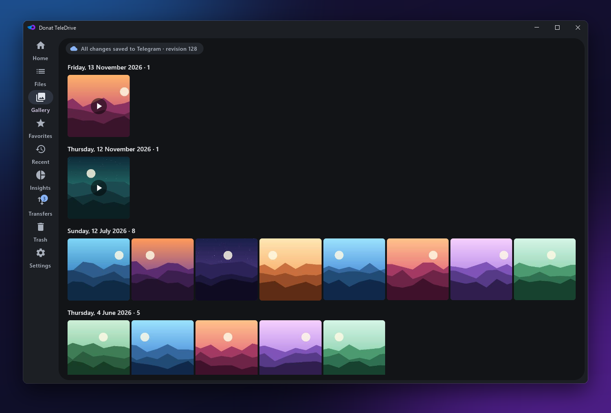</p>

### Preview — instant, smooth, in-window
Zoom at the cursor with the mouse wheel, pan by dragging, flip through files with ← →. Media plays inside the app; formats Windows can't play use a video engine fetched on demand — there is nothing to install.

<p align="center">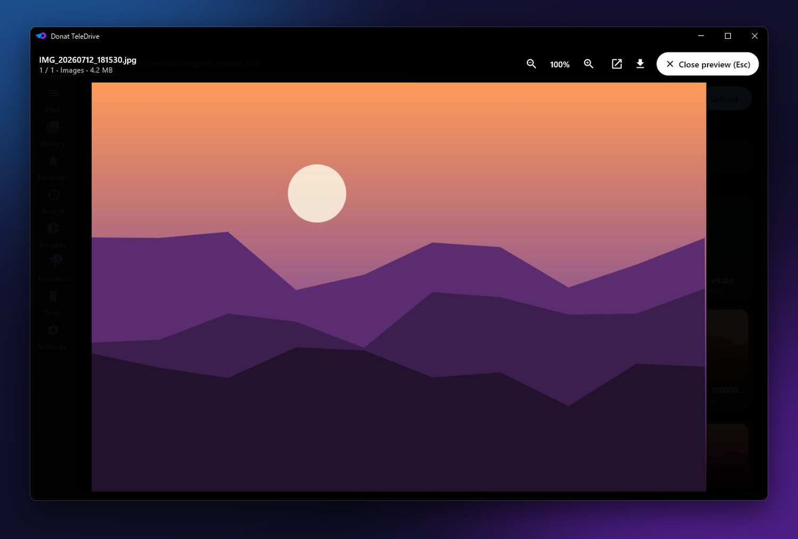</p>

### Transfers — always know what's happening
Real progress from confirmed bytes, speed and time left, pause / resume / cancel per item or all at once, and a clear reason whenever something waits.

<p align="center">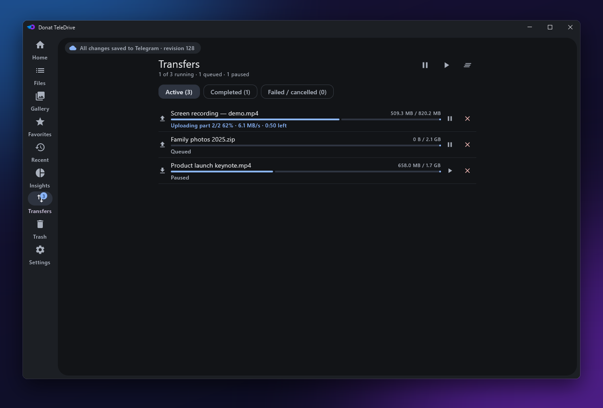</p>

### Search & details — find anything
Details view with sortable columns, search with type, date and size filters, Favorites and Recent. Explorer-style selection with <kbd>Ctrl</kbd> / <kbd>Shift</kbd>, <kbd>F2</kbd> rename, <kbd>Del</kbd> to Trash and Undo.

<p align="center"></p>

### Insights — reclaim space
The largest files and folders, and duplicate files detected by content (SHA-256) — keep one copy, send the rest to Trash in one click.

<p align="center">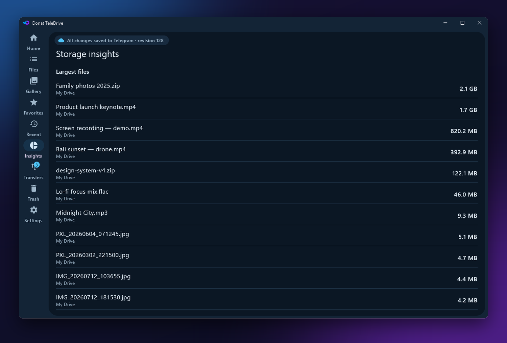</p>

### Eleven themes, one feel
System, Daylight, Graphite, Ocean, AMOLED, Sepia, Forest, Sakura, Sunset, Lavender and Neon — every chart colour validated for contrast on every theme.

<p align="center">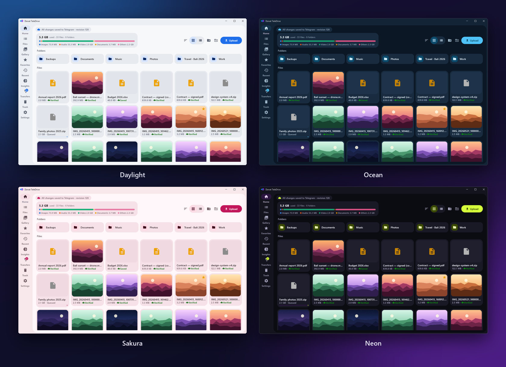</p>

<p align="center">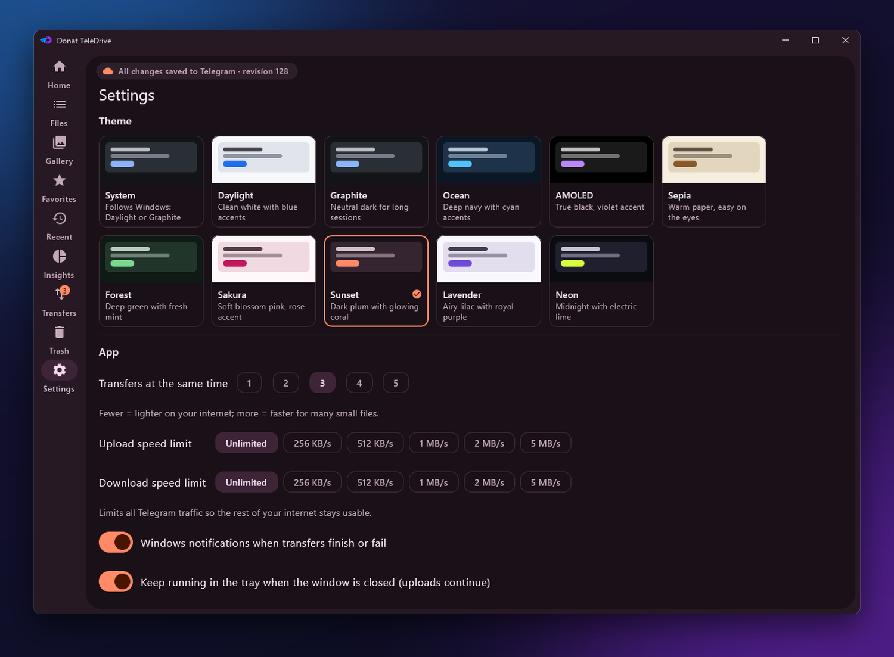</p>

### Made for any window size
Below phone width the layout switches to a slide-out menu, list rows and a floating Upload button — tidy at every size, no wasted space.

<p align="center">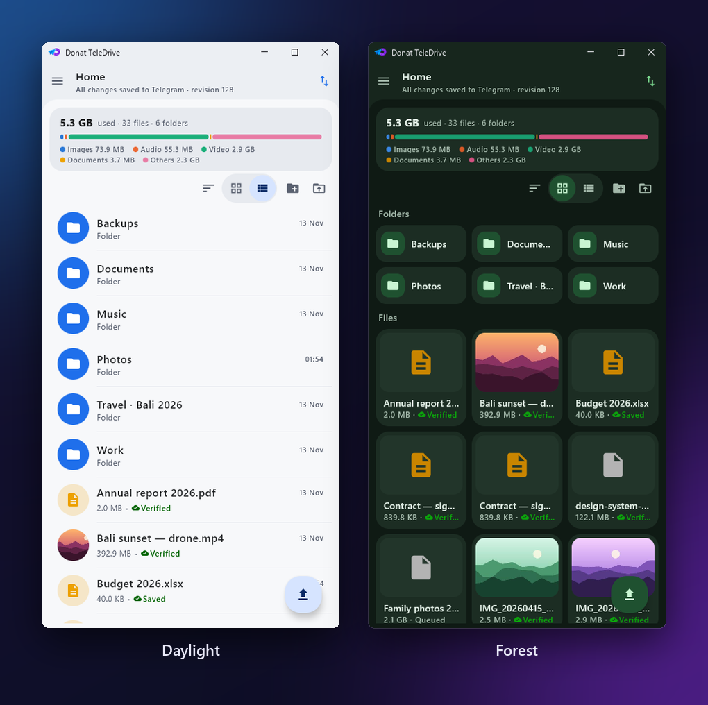</p>

### Sign in your way
Log in with a QR code from the Telegram app on your phone, or with your phone number (country picker included). Lock the app with a PIN if others share your PC.

<table>
  <tr>
    <td width="50%">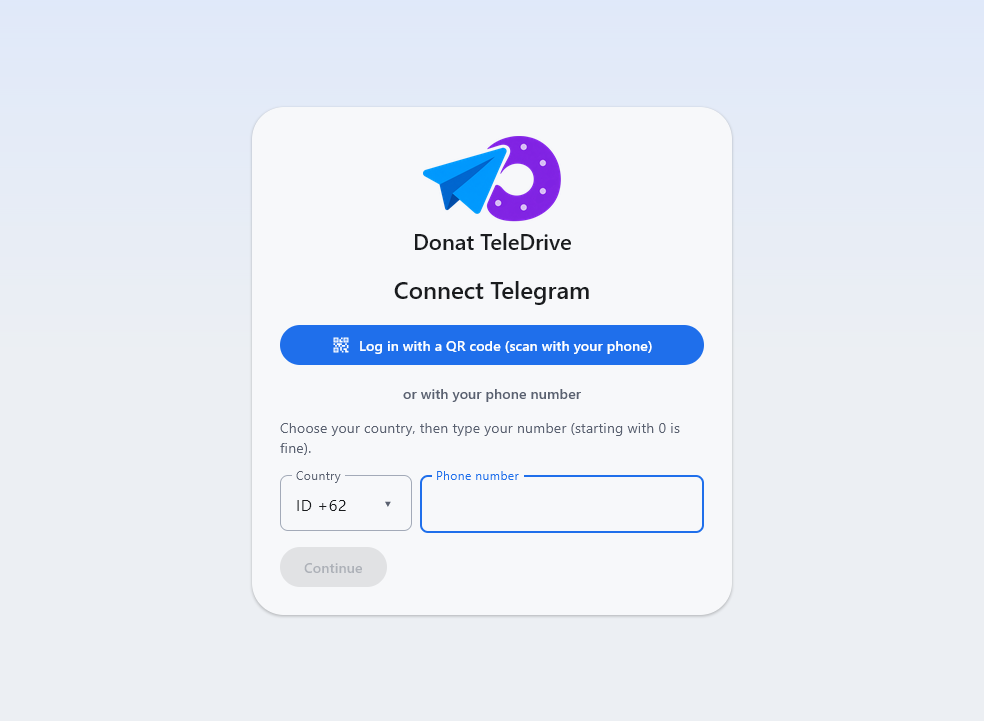</td>
    <td width="50%">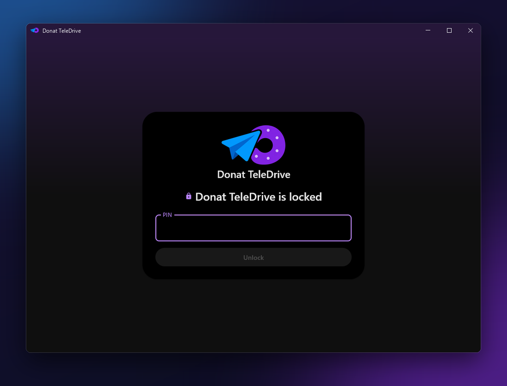</td>
  </tr>
</table>

---

## 📋 Everything it does

| Area | What you get |
| --- | --- |
| **File manager** | Folders, grid & details views, sorting, drag & drop in (files and folders) and onto folders, move dialog, rename, multi-select, keyboard shortcuts, Undo after delete |
| **Find** | Search with type / date / size filters and "only in this folder", Favorites, Recent, Gallery by date taken, Insights (largest, duplicates) |
| **Transfers** | Durable queue in SQLite, 1–5 in parallel, part-level resume, pause / resume / cancel, global back-off on Telegram FLOOD_WAIT, upload & download speed limits |
| **Integrity** | SHA-256 per part and per file, "Verify all files", corrupted parts detected and reported, dedup of identical content |
| **Safety** | Trash with restore, versions when a same-name file is uploaded again, nothing is ever silently overwritten |
| **Multi-PC** | Three-way merge of changes from several PCs; conflicting edits are kept and marked for review |
| **Recovery** | Rebuild the local index from Telegram any time; restore every drive on a new PC; adopt files found in the channel that the drive doesn't list (e.g. sent from your phone) |
| **Preview** | Images, PDF, text, ZIP listing, audio (mini player) and video (MP4/MOV in-app; MKV/HEVC/FLAC/AVI/WebM via an on-demand engine) |
| **Local network** | Optional web page for phones and PCs on the same Wi-Fi (browse, stream, download, upload) and expiring share links with QR codes |
| **Desktop** | Tray icon, Windows notifications, start with Windows, single instance, native dialogs, theme-coloured title bar, several drives per account |

---

## 🔒 Security & privacy

- **Your credentials stay yours.** The Telegram API ID/hash are encrypted with Windows DPAPI; the session is stored only on your PC.
- **Optional app PIN** — salted PBKDF2 (120 000 rounds), with a guessing brake that grows after every five misses and survives restarts.
- **Hardened local-network server** — 128-bit random keys, constant-time key checks, strict validation of every folder and file id, HTML/SVG always delivered as downloads, `nosniff` + `no-referrer`, keys never written to logs.
- **Safe file names** — names coming from Telegram are cleaned before they touch your disk, so a crafted name can never write outside the folder you chose.
- **Pentested** — every hardening has a test that attacks it, and a mutation run (`tools/mutate.ps1`) proves each test fails when its fix is removed: 23 of 24 mutants killed (the survivor only changes timing).
- **Not a chat client** — it never reads or shows your chats.

---

## 🧠 Under the hood

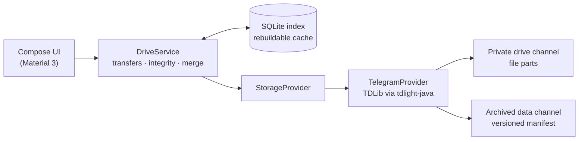

- **Telegram = file content.** One private channel per drive; big files are split into parts.
- **Manifest = source of truth.** A versioned JSON index in an archived companion channel, written in batches to stay far inside Telegram's rate limits.
- **SQLite = cache.** Delete it any time — it is rebuilt from the manifest.
- **Provider-neutral core.** Everything above `StorageProvider` knows nothing about Telegram.

---

<a id="download"></a>

## ⬇️ Download

<p align="center"><a href="https://abdani.github.io/Donat-TeleDrive/"><b>Homepage</b></a> · <a href="../../releases/latest"><b>Latest release</b></a> · Windows 10 / 11 (64-bit) · Java included</p>

| | Package | Best for |
| --- | --- | --- |
| 🧩 **Installer** (recommended) | [`Donat-TeleDrive-Setup.msi`](../../releases/latest/download/Donat-TeleDrive-Setup.msi) · 139 MB | Start menu & desktop shortcuts, per-user install (no admin), clean uninstall. Data in `%LOCALAPPDATA%\Donat TeleDrive`. |
| 🗂️ **ZIP** | [`Donat-TeleDrive-Windows.zip`](../../releases/latest/download/Donat-TeleDrive-Windows.zip) · 137 MB | Unzip anywhere and run `Donat TeleDrive.exe` — nothing installed. Data in `%LOCALAPPDATA%\Donat TeleDrive`. |
| 🔌 **Portable** | [`Donat-TeleDrive-Portable.zip`](../../releases/latest/download/Donat-TeleDrive-Portable.zip) · 137 MB | USB stick: everything lives in the `data` folder next to the exe and nothing is left on the PC. Keep it safe — it holds a signed-in session. |

SHA-256 checksums are on the release page. The files aren't code-signed yet: if SmartScreen appears, choose **More info → Run anyway**.

> 🐧 **Linux is on the way.** A Linux version (`.deb` and AppImage) is planned for a coming release. Click **Watch → Custom → Releases** at the top of this page to be notified when it lands.

**First start:** create an app at [my.telegram.org](https://my.telegram.org) → *API development tools*, paste the API ID and hash, then sign in with the QR code (Telegram on your phone → Settings → Devices → Link Desktop Device) or your phone number.

## 🛠️ Build from source

**You need**
- Windows 10 or 11 (x64)
- JDK 21 — for example [Eclipse Temurin 21](https://adoptium.net/)
- Your own Telegram **API ID** and **API hash** from [my.telegram.org](https://my.telegram.org) → *API development tools*

**Run**
```bat
git clone https://github.com/abdani/Donat-TeleDrive.git
cd Donat-TeleDrive
run.bat
```
`run.bat` builds the app (the first build takes a few minutes) and starts it. Enter your API ID and hash, then sign in with a QR code or your phone number. Create a drive — or, if you have used Donat TeleDrive before, your drives appear automatically.

**Tests and packages**
```bat
gradlew.bat jvmTest
gradlew.bat createDistributable packageMsi
```
The app folder lands in `build/compose/binaries/main/app`, the installer in `build/compose/binaries/main/msi`. A `data` folder next to `Donat TeleDrive.exe` switches that copy to portable mode.
Unit tests run in their own data folder (`build/test-appdata`) and never touch your real data or your Telegram account.

<details>
<summary>Developer tools</summary>

| Script | Purpose |
| --- | --- |
| `tools/mutate.ps1` | Mutation test of every security fix |
| `tools/capture.ps1` + `tools/showcase.py` | README screenshots from the demo UI (`gradlew jvmTest --tests donat.teledrive.UiDemoTest -PuiDemo=true`) |
| `tools/logo.py` | Pre-renders the logo and icons at exact pixel sizes |
| `tools/drag.ps1` | Measures repaint artifacts while resizing the window |

</details>

---

## ❓ FAQ

<details>
<summary><b>Is there a storage limit?</b></summary>

Telegram doesn't limit the total size of a channel. Single Telegram files are limited, so Donat TeleDrive splits big files into 512 MiB parts and joins them again on download.
</details>

<details>
<summary><b>What happens if I lose my PC?</b></summary>

Install Donat TeleDrive on another PC and log in with the same Telegram account: your drives, folders and file names come back from the index stored in Telegram. Files are downloaded only when you open them.
</details>

<details>
<summary><b>Are my files encrypted?</b></summary>

They are stored in a private channel only your account can see, and travel over Telegram's encrypted connection. End-to-end encryption with your own passphrase (AES-256-GCM) is on the roadmap.
</details>

<details>
<summary><b>Can I see the files on my phone?</b></summary>

Yes — the drive is a normal private channel in your Telegram app, showing just your files. Photos or videos you send there from your phone can be added to the drive with "Check for unlisted files".
</details>

---

## 🗺️ Roadmap

- [ ] **Linux version** (`.deb` and AppImage) — next up
- [ ] End-to-end encryption with a recovery passphrase
- [ ] Automatic backup of Windows folders
- [ ] Windows Hello unlock
- [ ] Share links that work outside your home network
- [ ] Android and web versions

---

## 🧱 Built with

| Component | Purpose | License |
| --- | --- | --- |
| [Kotlin Multiplatform](https://kotlinlang.org/docs/multiplatform.html) + [Compose Multiplatform](https://www.jetbrains.com/compose-multiplatform/) (Material 3) | The app and its whole interface | Apache-2.0 |
| [kotlinx.coroutines](https://github.com/Kotlin/kotlinx.coroutines), [kotlinx.serialization](https://github.com/Kotlin/kotlinx.serialization) | Background transfers, the JSON drive manifest | Apache-2.0 |
| [Room](https://developer.android.com/jetpack/androidx/releases/room) + [SQLite](https://sqlite.org) (bundled) | Local index of the drive (a rebuildable cache) | Apache-2.0, public domain |
| [TDLib](https://github.com/tdlib/td) via [tdlight-java](https://github.com/tdlight-team/tdlight-java) | Telegram login, channels, uploads and downloads | BSL-1.0, LGPL-3.0 |
| [JavaFX](https://openjfx.io) | In-app audio and video player (MP4, MP3, M4A, WAV) | GPL-2.0 with Classpath Exception |
| [vlcj](https://github.com/caprica/vlcj) + [VLC](https://www.videolan.org) *(downloaded only when needed)* | Playback of MKV, HEVC, FLAC, AVI and WebM | GPL-3.0, LGPL-2.1+ |
| [Apache PDFBox](https://pdfbox.apache.org) | PDF preview | Apache-2.0 |
| [LWJGL](https://www.lwjgl.org) + Native File Dialog | Modern Windows file and folder dialogs | BSD-3-Clause, zlib |
| [JNA](https://github.com/java-native-access/jna) | Windows DPAPI (encrypted login), colored title bar | Apache-2.0 / LGPL-2.1 |
| [QR Code generator](https://www.nayuki.io/page/qr-code-generator-library) by Project Nayuki | QR code login | MIT |
| [SLF4J](https://www.slf4j.org) (no-op) | Keeps TDLib's library logs out of the app | MIT |
| [Eclipse Temurin](https://adoptium.net) 21 | Java runtime bundled in the installer and the zips | GPL-2.0 with Classpath Exception |

VLC is downloaded from videolan.org (checksum-verified) only when a format needs it. Note that vlcj is GPL-3.0: a binary distribution that includes it must follow that license.

Donat TeleDrive is an independent project and is not affiliated with Telegram.

## License

[MIT](LICENSE) © 2026 Dani Abdani
