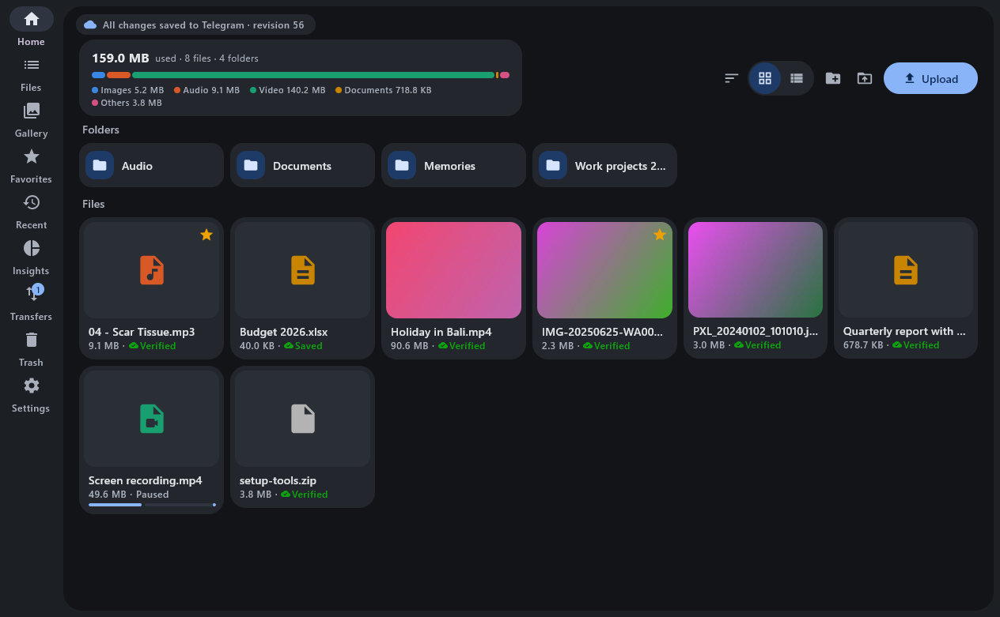
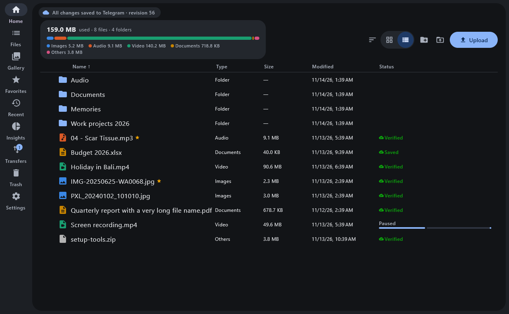
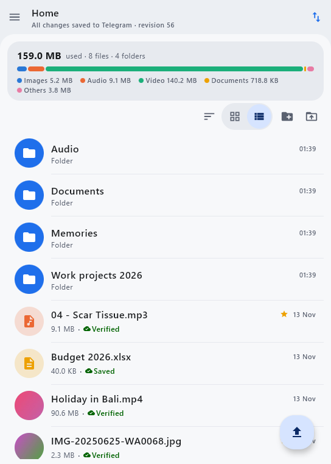

<p align="center">
  
</p>

<h1 align="center">Donat TeleDrive</h1>

<p align="center">
  A personal cloud drive for Windows that keeps your files in your own private Telegram channel.<br>
  It looks and works like a normal file manager — Telegram is only the storage behind it.
</p>

<p align="center">
  Windows 10/11 x64 · Kotlin + Compose Multiplatform · build from source
</p>



## Features

| Feature | Details |
| --- | --- |
| **Your storage, your account** | Files are uploaded to a private channel in *your* Telegram account. No third-party server, no extra cloud account. |
| **Real file manager** | Folders, grid and details views, sorting, drag & drop from Explorer (files and whole folders), drag onto a folder to move, rename, multi-select with <kbd>Ctrl</kbd>/<kbd>Shift</kbd>, keyboard shortcuts, Undo after delete. |
| **Find things** | Search with type, date and size filters; Favorites, Recent, a photo Gallery by date taken, and Insights (largest files, duplicates). |
| **Safe transfers** | Uploads and downloads survive restarts, run in parallel, pause/resume, honour Telegram's rate limits, and split big files into 512 MiB parts. Every part is checked with SHA-256. A file only shows *Saved* once it is listed in the drive's index on Telegram, and *Verified* after a byte-for-byte check. |
| **Recovery first** | The drive's index (folders, names, versions) lives in a hidden, archived Telegram channel. On a new PC you log in and everything is back. Even if that index is lost, the files are found again by name. |
| **Several PCs** | Changes made on two PCs are merged; when both changed the same file, the newer one wins and the item is marked for review — nothing is silently overwritten. |
| **Trash & versions** | Delete goes to Trash first. Uploading a file with the same name keeps the old one as a version you can restore. |
| **Preview** | Images (zoom, pan), PDF, text, ZIP contents, audio and video. Common formats play in-app; MKV/HEVC/FLAC/WebM use a video engine that is downloaded on demand (nothing to install). Audio keeps playing in a mini player. |
| **Security** | Telegram API credentials are encrypted with Windows DPAPI. Optional app PIN (salted PBKDF2, guessing brake that survives restarts). Integrity check on demand. |
| **Local network** | Optional web page for phones and PCs on the same Wi-Fi (browse, stream, download, upload) and expiring share links with a QR code. Off by default. |
| **Look** | Material 3 design with 11 themes (follows Windows light/dark by default), a phone-style layout for narrow windows, tray icon, Windows notifications, optional start with Windows, upload/download speed limits. |

## Screenshots

| Details view | Narrow window, light theme |
| --- | --- |
|  |  |

| Log in with a QR code or your phone number |
| --- |
|  |

## Getting started

**You need**
- Windows 10 or 11 (x64)
- JDK 21 (for example [Eclipse Temurin 21](https://adoptium.net/))
- Your own Telegram **API ID** and **API hash**: log in at [my.telegram.org](https://my.telegram.org) → *API development tools* → create an app. They stay on your PC, encrypted.

**Run**
```bat
git clone https://github.com/abdani/Donat-TeleDrive.git
cd Donat-TeleDrive
run.bat
```
`run.bat` builds the app (first time takes a few minutes) and starts it. Enter your API ID and hash, then log in with a QR code from the Telegram app on your phone, or with your phone number. Create a drive — or, if you used Donat TeleDrive before, your drives are found automatically.

**Tests**
```bat
gradlew.bat jvmTest
```
Unit tests use their own data folder (`build/test-appdata`) and never touch the app's real data or your Telegram account.

## How it works

- **Telegram = file content.** Each drive is one private channel; files are sent as documents (big files in parts).
- **Drive index = source of truth.** A versioned JSON manifest in an archived companion channel holds folders, names, safety states and part references. It is written in batches to stay well inside Telegram's rate limits.
- **SQLite = cache.** The local database (`%LOCALAPPDATA%\Donat TeleDrive\index.db`) can be deleted at any time and is rebuilt from the index.
- Telegram is reached through [TDLib](https://github.com/tdlib/td) via [tdlight-java](https://github.com/tdlight-team/tdlight-java). The app is not a chat client: it never reads or shows your chats.

## Privacy & security notes

- Nothing leaves your PC except the traffic to Telegram (and, if you turn it on, the local-network page on your Wi-Fi).
- The local-network page and share links are protected by long random keys; pages and scripts are never executed from it (HTML/SVG files are always downloaded).
- File names coming from Telegram are cleaned before they touch the disk, so a crafted name can't write outside the chosen folder.
- Logs (`%LOCALAPPDATA%\Donat TeleDrive\app.log`) never contain your API hash, phone number, codes, passwords or link keys.

## Third-party software

Compose Multiplatform, Room/SQLite and kotlinx (Apache-2.0), TDLib (BSL-1.0), tdlight-java (LGPL-3.0), JavaFX (GPL-2.0 with Classpath Exception), Apache PDFBox (Apache-2.0), LWJGL (BSD-3-Clause), JNA (Apache-2.0), QR Code generator by Project Nayuki (MIT), vlcj (GPL-3.0). VLC is downloaded from videolan.org only when a format needs it. Note that vlcj is GPL-3.0: a binary distribution that includes it must follow that license.

Donat TeleDrive is an independent project and is not affiliated with Telegram.

## License

[MIT](LICENSE) © 2026 Dani Abdani
